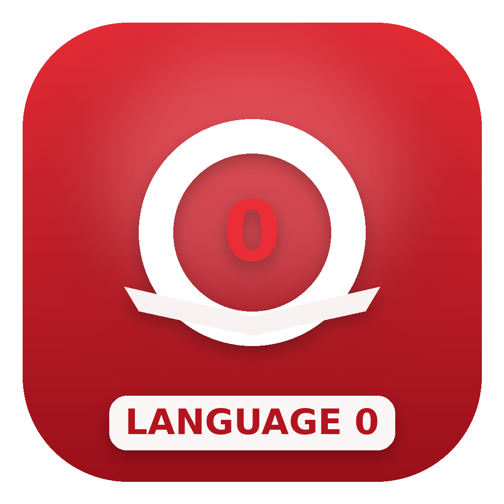

# language 0

<p align="center">
  
</p>

<p align="center">
  <b>แอปพลิเคชันฝึกทักษะภาษาญี่ปุ่นและภาษาอังกฤษตั้งแต่ระดับเริ่มต้น (0 to Hero)</b><br/>
  พร้อมระบบ AI ติวเตอร์ส่วนตัว, ฝึกเขียนเส้นอักษร, ฝึกออกเสียงเงา (Shadowing), และระบบ GitHub Auto-Updater
</p>

---

## 🌟 ฟีเจอร์หลัก (Key Features)

1. **🎌 ตารางตัวอักษร & ทักษะการเขียน (Kana & Phonics Practice)**
   - ตารางตัวอักษรฮิรางานะ / คาตาคานะ พร้อมระบบประเมินเส้นเขียน (Stroke Order Evaluator) แบบเรียลไทม์
   - แอนิเมชันรูปปาก (Mouth Shape) และเสียงอ่านมาตรฐาน (TTS)

2. **🎧 การฝึกพูดตามเสียงจริง (Shadowing)**
   - บทเรียนบทสนทนาสถานการณ์จริง (NHK Japanese & English Phonics)
   - เครื่องมือบันทึกเสียงและฟังเปรียบเทียบกับต้นฉบับ

3. **🤖 AI ติวเตอร์ส่วนตัว (Local LLM via Ollama)**
   - เชื่อมต่อ Ollama (เช่น Gemma 4: 31B, Llama 3) บนเครื่องโลคอล
   - ตรวจสอบไวยากรณ์, สนทนาโต้ตอบ, และวิเคราะห์แนวทางการเรียนรู้เฉพาะบุคคล

4. **📊 แดชบอร์ดสรุปความคืบหน้า (Progress Dashboard)**
   - บันทึกสถิติการเรียนรู้, อักษรที่ฝึกผ่านแล้ว, และคะแนนแบบทดสอบ

5. **🚀 ระบบอัปเดตแอปอัตโนมัติจาก GitHub (GitHub Auto-Updater)**
   - ตรวจจับเวอร์ชันใหม่ล่าสุดจาก GitHub Releases อัตโนมัติเมื่อเปิดแอป
   - รองรับ **Background Download** ดาวน์โหลดไฟล์ `.apk` ในพื้นหลังขณะใช้งานแอป
   - มีระบบ **Clean Cache** ลบไฟล์ติดตั้งอัตโนมัติเมื่อเสร็จสิ้นเพื่อประหยัดพื้นที่อุปกรณ์

---

## 📦 การติดตั้งและการรัน (Getting Started)

### ความต้องการของระบบ (Prerequisites)
- Flutter SDK >= 3.13.7
- Dart SDK >= 3.13.7
- Android Studio / VS Code
- GitHub CLI (`gh`) สำหรับระบบ Release

### รันแอปพลิเคชัน
```bash
# ติดตั้ง dependencies
flutter pub get

# ตรวจสอบโค้ด
flutter analyze

# รันแอปบนอุปกรณ์หรือ emulator
flutter run
```

---

## 🚀 การ Release ขึ้น GitHub ด้วย `release.sh`

มีสคริปต์อัตโนมัติ `release.sh` สำหรับการจัดการ Versioning, Build APK, แท็ก Git, และอัปโหลดขึ้น GitHub Releases:

```bash
# แบบโต้ตอบ (Interactive): เลือกระดับเวอร์ชันและพิมพ์ข้อความ Release
./release.sh

# หรือระบุประเภทการอัปเดตโดยตรง:
./release.sh patch "แก้บั๊กและปรับปรุงประสิทธิภาพ"   # เช่น 1.0.0 -> 1.0.1
./release.sh minor "เพิ่มบทเรียนใหม่และฟีเจอร์ AI"    # เช่น 1.0.0 -> 1.1.0
./release.sh major "อัปเกรดดีไซน์และโครงสร้างหลัก"    # เช่น 1.0.0 -> 2.0.0
./release.sh 1.2.5 "กำหนดเลขเวอร์ชันเองได้"
```

สคริปต์จะทำงานตามขั้นตอนต่อไปนี้อัตโนมัติ:
1. ปรับปรุงเวอร์ชันใน `pubspec.yaml`
2. คอมไพล์ APK รีลีส (`flutter build apk --release`)
3. สร้าง Git Commit และ Git Tag (`vX.Y.Z`)
4. พุชขึ้น GitHub Repository (`main` + tags)
5. สร้าง GitHub Release พร้อมแนบไฟล์ `language-0-vX.Y.Z.apk` ให้อัตโนมัติ
